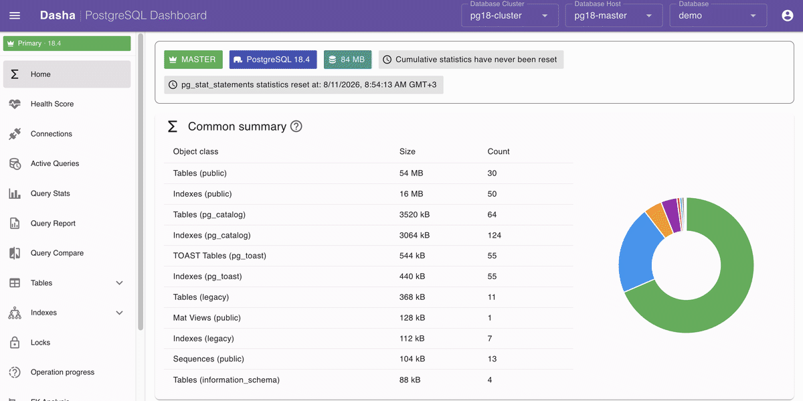

<p align="center">
  
</p>

PostgreSQL performance dashboard for analyzing database cluster health, identifying problems, and providing optimization recommendations.

[Russian / Русская версия](README.ru.md)

[](https://github.com/dbulashev/dasha/actions/workflows/ci.yaml)
[](https://hub.docker.com/r/dbulashev/dasha-backend)
[](https://hub.docker.com/r/dbulashev/dasha-frontend)


<p align="center">
  
</p>

| | |
|---|---|
| **Cluster discovery** | Static list in `dasha.yaml`, **Patroni** clusters from **etcd v3** or **Consul** (members, roles, standby cluster links), **Yandex Managed Service for PostgreSQL**; databases discovered from the cluster itself, no restart needed — [Patroni](doc/en/configuration.md#patroni-clusters-from-etcd-or-consul-optional) · [Yandex MDB](doc/en/configuration.md#yandex-mdb-service-discovery-optional) · [databases](doc/en/configuration.md#database-discovery-inside-a-cluster-optional) |
| **Log search** | PostgreSQL and pooler logs from **VictoriaLogs**, **OpenSearch / Elasticsearch** or the Yandex MDB API: filters, deduplication by template, histogram, presets — [setup](doc/en/configuration.md#log-search-optional) · [VictoriaLogs](doc/en/configuration.md#victorialogs-sources) · [OpenSearch](doc/en/configuration.md#opensearch-sources) |
| **Plans from logs** | `auto_explain` plans grouped by statement and shape, plan regressions between windows, plan evidence for index recommendations — [Log insights](doc/en/configuration.md#log-insights) |
| **Health Score** | 0–100 score with prioritized recommendations; point-in-time SQL out of the box, or trend and seasonal baseline from **Prometheus / VictoriaMetrics** (pgSCV, Yandex MDB, pgbouncer, host metrics) — [model](README-health-score.md) · [metrics mode](README-health-score.md#metrics-backed-mode-history-baseline-richer-signals) |
| **Index advisor** | Missing btree indexes proposed from `pg_stat_statements` parsed with the PostgreSQL parser, with a ready `CREATE INDEX` — [setup](doc/en/configuration.md#index-recommendations-optional) |
| **Snapshots** | `pg_stat_statements`, lock and hot-object snapshots, comparison, auto-snapshots on activity spikes and failovers — [Snapshots](doc/en/autosnapshot.md) |
| **Schema checks** | 17 structural checks with fixes, from sequence exhaustion to tables without a primary key — [setup](doc/en/configuration.md#schema-checks-optional) |
| **Access control** | `none` / static tokens / **OIDC** (Keycloak, Google, …), `admin` and `viewer` roles, personal access tokens — [Authentication](doc/en/auth.md) |
| **AI assistants** | `dasha-mcp`: read-only MCP server, 34 tools for fleet diagnostics — [MCP connector](doc/en/mcp.md) |
| **Deployment** | Docker Compose, Docker Hub images, Helm chart — [Deployment](doc/en/deployment.md) |

PostgreSQL 14–18 and Postgres Pro (`pgpro_stats` is picked up automatically).

## Features

[Query Analysis](doc/en/features.md#query-analysis) ·
[Index Analysis](doc/en/features.md#index-analysis) ·
[Table Analysis](doc/en/features.md#table-analysis) ·
[Foreign Key Analysis](doc/en/features.md#foreign-key-analysis) ·
[Maintenance & Vacuum](doc/en/features.md#maintenance--vacuum) ·
[Connections & Locks](doc/en/features.md#connections--locks) ·
[I/O](doc/en/features.md#io-pg_stat_io-postgresql-16) ·
[Progress Tracking](doc/en/features.md#progress-tracking) ·
[Settings Analysis](doc/en/features.md#settings-analysis) ·
[Schema Checks](doc/en/features.md#schema-checks) ·
[Health Score](doc/en/features.md#health-score) ·
[Log Search](doc/en/features.md#log-search) ·
[Log Insights](doc/en/features.md#log-insights) ·
[Authentication & Authorization](doc/en/features.md#authentication--authorization) ·
[Infrastructure](doc/en/features.md#infrastructure) ·
[User Preferences](doc/en/features.md#user-preferences) ·
[Auto-snapshots](doc/en/autosnapshot.md) ·
[MCP connector](doc/en/mcp.md)

The full list with details: [doc/en/features.md](doc/en/features.md).

## Quick Start

> [!TIP]
> **Demo lab**
> ```bash
> git clone --depth 1 https://github.com/dbulashev/dasha.git && cd dasha
> make demo-lab        # http://localhost:3000
> ```
> A PostgreSQL 18 cluster with a replica, a load generator and the MCP server. No login needed.
>
> **Full demo lab**
> ```bash
> make demo-lab-full
> ```
> Adds two more PostgreSQL clusters, an OIDC provider, metrics and log search.
> Log in through Keycloak: `admin`/`admin`.
>
> More on the demo labs: [doc/en/development.md](doc/en/development.md#demo-lab).

For your own clusters, create `dasha.yaml` (searched in `.`, `$HOME/.dasha/`, `/etc/dasha/`):

```yaml
clusters:
  - name: production
    username: monitoring_user
    password: secret
    port: 5432
    databases:
      - myapp
    hosts:
      - pg-master.example.com
      - pg-replica-1.example.com
```

The role Dasha connects as needs `CONNECT` on every monitored database; with `pg_monitor` it sees the statements of the other roles too:

```sql
CREATE ROLE monitoring_user LOGIN PASSWORD 'secret';
GRANT pg_monitor TO monitoring_user;
GRANT CONNECT ON DATABASE myapp TO monitoring_user;
```

Without `pg_monitor` the query report and the Top 10 panels hold the statements of that role alone.

Run with the pre-built images:

```bash
cd deploy/compose
# Edit dasha.yaml with your cluster settings
docker compose up -d
# Open http://localhost:3000
```

Everything else — service discovery, log search, schema checks, authentication, snapshot
storage — is optional and documented in [Configuration](doc/en/configuration.md).

## Documentation

| Document | Contents |
|---|---|
| [Features](doc/en/features.md) | Full capability list by domain |
| [Architecture](doc/en/architecture.md) | Components, data flows, technology stack |
| [Configuration](doc/en/configuration.md) | `dasha.yaml`, service discovery, log search, schema checks |
| [Authentication](doc/en/auth.md) | `none` / `token` / OIDC modes, RBAC, personal access tokens |
| [Snapshots](doc/en/autosnapshot.md) | Snapshot storage and the auto-snapshot daemon |
| [Deployment](doc/en/deployment.md) | Docker Compose, images, Helm chart |
| [MCP connector](doc/en/mcp.md) | `dasha-mcp` — read-only diagnostics for AI assistants |
| [Development](doc/en/development.md) | Local run, demo lab, project layout, code generation, CI/CD |
| [Health Score model](README-health-score.md) | Formula, weights, all rules and thresholds |

Russian translation: [doc/ru/](doc/ru/) — except the Health Score model, which keeps its own
root-level file, [README-health-score.ru.md](README-health-score.ru.md).

## Changelog

See [CHANGELOG.md](CHANGELOG.md) for release notes.

## Authors
* [Dmitry Bulashev](https://dbulashev.github.io/)

## Contributors

* [Anton Glushakov](https://github.com/glushakov)
* [Mikhail Grigorev](https://github.com/cherts)
* [Ilya Lukyanov](mailto:lukyanov1985@gmail.com)
* [Roman Minebaev](https://github.com/minebaev)
* [Rustem Sagdeev](https://github.com/SagdeevRR)

## Third-party components

Many of the index, table, maintenance, connection, replication and running/blocked query checks are
derived from [pghero](https://github.com/ankane/pghero) (MIT, © 2014-2026 Andrew Kane, 2008-2014 Heroku).
Licence text: [backend/internal/query/LICENSE-pghero](backend/internal/query/LICENSE-pghero);
per-template attribution: [backend/internal/query/README.md](backend/internal/query/README.md).

The SQL behind **Schema Checks** is derived from [db_verifier](https://github.com/sdblist/db_verifier)
(MIT, © 2024 Nikonov — licence text in the project's `LICENSE` file), a set of structural checks for
PostgreSQL. Per-template attribution: [backend/internal/query/README.md](backend/internal/query/README.md).

The **lock tree** query comes from [postgres_dba](https://github.com/NikolayS/postgres_dba)
(BSD 3-Clause, © 2017 Nikolay Samokhvalov) — `sql/l2_lock_trees.sql`, adapted to run as a single
statement without psql version branches. Licence text:
[backend/internal/query/LICENSE-postgres_dba](backend/internal/query/LICENSE-postgres_dba).

Index bloat estimation, taken from pghero, descends from [pgsql-bloat-estimation](https://github.com/ioguix/pgsql-bloat-estimation)
(BSD-style — the PostgreSQL licence, © 2015-2019 Jehan-Guillaume (ioguix) de Rorthais; licence text in the
project's `LICENSE` file).

Table bloat estimation comes from [pgx_scripts](https://github.com/pgexperts/pgx_scripts)
(BSD 3-Clause, © 2014 PostgreSQL Experts, Inc.) — `bloat/table_bloat_check.sql`. Licence text:
[backend/internal/query/LICENSE-pgx_scripts](backend/internal/query/LICENSE-pgx_scripts).

## License

[GNU General Public License v3.0](LICENSE)
